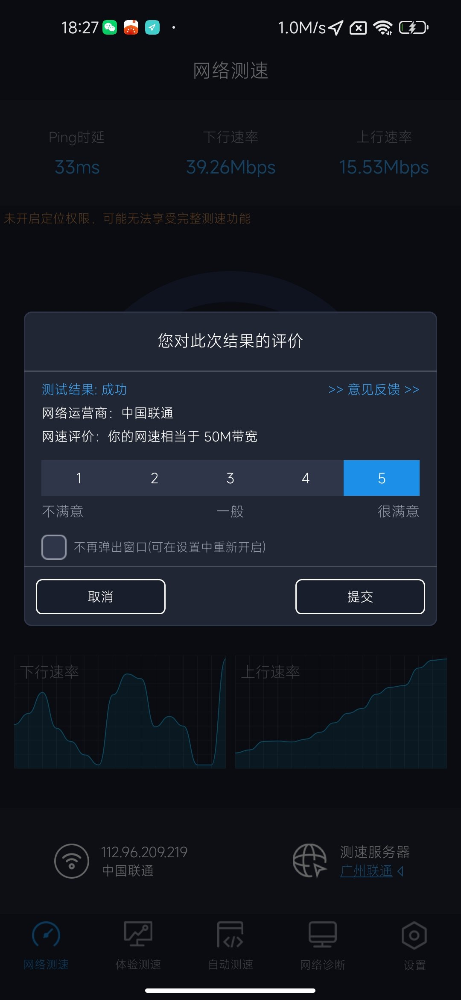

# luci-app-prio

给 OpenWrt / ImmortalWrt 用的**设备优先级**插件。

按设备把下行、上行流量分成 3 / 4 / 8 个优先级带，用 `tc htb` + `sch_ets`（严格优先）+
`fq_codel` 调度，让"打游戏的设备"在"别人下载/上传"时仍然保持低延迟。界面全中文。

```
带 0  >  带 1  >  带 2（只拿剩余）
```

[](https://github.com/fyhbauyg/luci-app-prio/actions/workflows/ci.yml)
[](https://github.com/fyhbauyg/luci-app-prio/actions/workflows/release.yml)
[](https://github.com/fyhbauyg/luci-app-prio/releases)

## 界面

[](docs/img/luci.jpg)

<sub>点击看原图。状态区同时在报"总闸 246.8 Mbit/s / 低优先带阀门 197.3 Mbit/s"、
当前 RTT 和队列是否空闲。</sub>

## 效果

下面两张截图是**同一时刻、两台设备同时开测速**的结果——截图时间都是 18:27，
一台在优先级带 0，一台在优先级带 2，两台互相抢同一条 5G-A 线路。
**注意：两台是同时测的，不是先后测的。**

| 带 0（最高优先级） | 带 2（最低优先级） |
|:---:|:---:|
|  |  |
| 下行 **95.07** Mbit/s<br>上行 **124.22** Mbit/s<br>ping **28** ms | 下行 **39.26** Mbit/s<br>上行 **15.53** Mbit/s<br>ping **33** ms |

当时路由器上的状态：总闸 246.8 Mbit/s、低优先带阀门 197.3 Mbit/s、安全余量 20%、
上行实测 171.1 Mbit/s、3 个带、2 层严格优先。

两台加起来 134 Mbit/s，都还在总闸之下，所以带 2 也没有被"惩罚"到几乎没网——
真正的差别是**带 0 在抢带宽的时候 ping 只有 28 ms**，而不是几秒钟。

> 说明：带 0 不限速是刻意的。它的作用是在别人下载时保住低延迟，
> 不是把别人的带宽掐死。

## 为什么需要它

普通的路由器限速（或单纯开个 qdisc）在 5G-A / 5G 这类"模组自带大缓冲"的线路上是无效的：
只要不限速，包装满运营商的缓冲网络，队列根本不在路由器里，优先级就无从谈起。

实测（NRadio C2000-MAX，5G-A 插卡，同一批下载流量）：

| 路由器下行限速 | 到公网的往返延迟 |
|---|---|
| 20 Mbit/s | **1068 ms** |
| 14 Mbit/s | **1670 ms** |
| 8 Mbit/s | **32 ms** |
| 5 Mbit/s | **31 ms** |
| 0.5 Mbit/s（几乎空闲） | **30 ms** |

也就是说：**限速必须低于线路真实能力**，队列才会留在路由器里。而这个"真实能力"
在 5G-A 线路上会在一个小时内从 161 Mbit/s 掉到 8 Mbit/s —— 任何静态数字都会有一段时间是错的。

所以本插件把两件事分开做：

- **容量靠实测**：路由器用固件自带的测速客户端（`cnspeedtest`，自动挑大陆节点，
  多线程并发）跑一次，**实测值原样作为总闸**。这是唯一能把速率**调高**的途径。
  低优先带的阀门 = `总闸 × (100 − 安全余量)%`，带 0 不设阀门。
- **延迟只负责下调**：空闲时用 ping 的最小值学一个延迟基线；有流量时每约 20 秒测一次
  平均值，超过基线 + 300 ms 就按超出量把限速下调 **10%–30%**，其余时间不动。
  三个窗口都收不到回包时判定探测目标不可用，不继续下调，而是安排一次新的实测。

自动抬速**不存在**：延迟只能说明"有队列"，永远说明不了"能装多少比特"——这是四轮
审计给出的同一个结论。

上传打满 45 Mbit/s 时，ping 仍为 21–85 ms（之前是 1.7 秒）。

## 下载

所有版本都在 [Releases](https://github.com/fyhbauyg/luci-app-prio/releases) 里，
每个版本带两个包（`all` 架构，任何 OpenWrt 设备都能装）：

| 文件 | 用途 |
|---|---|
| `luci-app-prio-*.apk` | 插件本体（引擎 + 页面 + 菜单 + ACL） |
| `luci-i18n-prio-zh-cn-*.apk` | 中文翻译 |

`lmo` 二进制不能跨 LuCI 版本复用，所以翻译包是按编译时的 luci feed 版本号命名的；
版本号对不上时自己从源码编一遍即可（见下）。

## 要求

- OpenWrt / ImmortalWrt 21.02 以上（apk 与 opkg 均可），已在 ImmortalWrt 25.12 / kernel 6.12 / MT7987B 上验证
- 依赖：`tc-full`、`kmod-sched-core`、`kmod-sched`、`luci-compat`
  （`sch_htb` / `sch_fq_codel` 由 `kmod-sched-core` 提供，`kmod-sched` 会带上 `sch_ets`）
- 可选：`cnspeedtest`（固件自带，用于实测容量；没有时回退到内置的 HTTP 测速）
- 可选：`curl` + `jq`（内置 HTTP 测速回退要用；`cnspeedtest` 存在时不需要）
- 可选：`traceroute`（只用于"挑选探测目标"按钮；没装时按钮自动隐藏，不影响其它功能）
- **必须关掉硬件 HNAT**（插件会自动切换成软件流量分载，否则 qdisc 被绕过）

## 安装

```sh
apk add --allow-untrusted --force-overwrite luci-app-prio-*.apk
apk add --allow-untrusted --force-overwrite luci-i18n-prio-zh-cn-*.apk
/etc/init.d/prio reload
```

opkg 系统把 `apk add` 换成 `opkg install`。然后在 LuCI 里打开
「网络 → 设备优先级」，勾选**启用设备优先级**，保存。

### 从源码编译

把整个目录放进 OpenWrt 源码树的 `package/custom/luci-app-prio`，然后：

```sh
make package/luci-app-prio/compile V=s
```

产物在 `bin/packages/<arch>/base/luci-app-prio-*.apk`。

## 配置项

| 选项 | 说明 |
|---|---|
| `enabled` | 总开关。关闭时恢复原来的加速模式 |
| `auto_hnat_off` | 强制使用软件流量分载（默认 1，必须开） |
| `auto_bandwidth` | 自动调速（延迟闭环）。关闭后使用固定的 `shaper_kbit` |
| `rtt_target` | 延迟探测目标。必须是**公网**地址，表单会拒绝内网/回环地址 |
| `shaper_margin` | 低优先带的余量百分数：带 0 不设限，其余带按 (100 − 此值)% 封顶（0–50） |
| `shaper_kbit` | 固定下行速率（`auto_bandwidth=0` 时使用；自动模式下被忽略） |
| `uplink_kbit` | 上行整形速率。0 = 自动（先测量再整形）；填 ≥1000 则固定用这个值 |
| `bands` | 优先级带数量：3 / 4 / 8 |
| `strict_bands` | 严格优先的层数。3 带时填 2 = 带 0 > 带 1 > 带 2 |
| `fq_codel` | 每带加 fq_codel，防止单条流饿死同带其它流 |
| `lan_shaping` / `lan_rate_kbit` | 是否对局域网内流量也排队 |
| `wan_iface` / `lan_iface` | 挂载点，默认 `eth2` / `br-lan` |

设备列表里每个设备填 IPv4、选优先级带（上传和下载共用；想分开设就在上面打开
"分开设置上传优先级"）。不在列表里的设备同样会经过整形器，落到"未列出设备的优先级"。

## 自测

仓库里带了逐项 PASS/FAIL 的自测脚本：绝大部分是只读检查，但**会**临时改写上行
速率、清空学习值（相当于手动删掉学习到的速率）并跑一次实测容量（快线上约 300 MB 流量），结束时恢复原值：

```sh
sh tools/prio-selftest.sh
```

覆盖：服务状态、上下行 qdisc/class/ets/fq_codel 结构、速率与配置一致性、延迟基线、
nft 标记与 IPv6 集合、探测目标可达性、实测容量命令与记录、清空学习值、停止/启动、
LuCI 模型语法、中文翻译、以及"后台进程不会改回自动开关"。

## 工作原理

```
下行 (br-lan)
  htb 1: root
   ├ 1:1    10Gbit          ← 不带标记的流量（局域网）
   └ 1:100  <总闸>           ← 互联网流量，= 上一次实测容量
        └ ets 2: bands N strict K
             ├ 2:1  带 0    ← 直挂 fq_codel，不设阀门，可吃满总闸
             ├ 2:2  带 1 → 21: htb <阀门>
             └ 2:3  带 2 → 22: htb <阀门>

上行 (eth2) 结构相同：1:100 是上行总闸，低优先带各自挂在 21: / 22: 阀门下
```

总闸跟实测容量走，**阀门只压低压带**（带 0 没有阀门类）。
分类在 NAT **之前**用 nftables 给包打 `fwmark`，因此分类结果在地址转换后依然有效；
IPv6 地址从邻居表定期补进 nft set。

## 版本与发布

版本号形如 `1.0.0-r110`，tag 形如 `v1.0.0-r110`。

- CI（[.github/workflows/ci.yml](.github/workflows/ci.yml)）：每次 push 检查 shell 语法
  （`sh` 与 `busybox ash` 各一遍）、`shellcheck`、Lua 语法、JSON 合法性、`msgfmt` 翻译检查。
- 发布（[.github/workflows/release.yml](.github/workflows/release.yml)）：打 tag 自动发版，
  或者到 Actions 页面手动跑一次 `Release` 并填 tag。产物取自 `dist/`（编译机产出的
  `all` 架构包），附 `sha256sums.txt`。

## 已知限制

- 延迟基线只在线路空闲时学习。如果长时间不间断有流量，控制器会短暂"冻结"（不动作，也不会乱调）
- 实测容量只在线路空闲时进行（会占用几秒带宽，实测约 100–200 MB 流量）
- 上行整形默认自动：在测到三次干净的上传窗口之前，上行是不限速的（队列会落在模组里）
- 上行种子只接受"模组没有堆积"的窗口（窗口内 RTT 未超过基线 +80 ms），
  取三个窗口的中间值作为总闸（带 0 可用满），低优先带再按 `shaper_margin` 压到 (100 − m)%，
  这样带 0 能跑满实测容量，低优先带仍然待在延迟拐点之下
- 严格优先层数设得越多，低优先级带越容易被饿死（3 带 + 2 层严格时，带 2 只拿剩余）

## License

Apache-2.0
